# StormRoute — Weather-Aware Truck Routing

A React + Django app that helps a truck driver choose the safest route. It generates three route options, samples the forecast at each checkpoint **at the hour the truck will actually get there** (including mandatory rest stops), scores weather risk with the assessment's risk and load rules, and recommends a route.

- **Live demo:** _add link_
- **Walkthrough (Loom):** _add link_


---

## Requirements → implementation

| Requirement (assessment PDF) | Where / how |
| --- | --- |
| Origin, destination, departure date/time, load weight | `TripForm.tsx`: geocoder autocomplete (or raw `lat, lon`), local `datetime-local` sent as UTC ISO |
| 3 route options from a routing API | `services.get_route_options`: OSRM alternatives, topped up with via-point detours until there are 3 distinct routes (each shares < 80 % of its length with the others) |
| Sample weather every 10 / 25 / 50 mi | User-selectable; `services.build_checkpoints` places checkpoints at exact mile marks plus the destination |
| …using the truck's ETA at each checkpoint | Per-segment travel times from the routing engine, capped at truck speed, plus FMCSA hours-of-service stops (`hos.py`) |
| Risk rules (wind / rain / snow) + load rules | `risk.py`, unit-tested at every band edge |
| Recommend balancing risk and time | `services.rank_key`: No Travel mi → Severe mi → High mi → unforecast mi → avg risk → time; the UI explains *why* |
| All routes, checkpoints, risk levels, ETAs, summaries on a map | Risk-coloured selected route, checkpoint markers with ETA/weather tooltips, route summary tooltips, route cards, KPI tiles |
| Weather heatmap along the corridor with a 0–48 h slider | `/api/heatmap` + `HeatLayer.ts`: all 49 hours fetched once; scrubbing and playback never hit the network |

## How it works

```mermaid
flowchart LR
  A[Trip form] -->|POST /api/plan| B[Geocode<br/>Nominatim]
  B --> C[3 route options<br/>OSRM or ORS-HGV]
  C --> D[Checkpoints every N mi<br/>+ truck speed cap + HOS stops]
  D --> E[Open-Meteo hourly forecast<br/>batched, cached]
  E --> F[Risk per checkpoint<br/>spec rules + load rules]
  F --> G[Rank & recommend]
  G -->|routes, checkpoints, stops, POIs| H[Map + sidebar]
  H -->|POST /api/heatmap corridor| I[Grid around routes<br/>49 hourly frames]
  I --> J[Canvas heat layer<br/>+ 0–48 h slider]
```



### Routes
The public OSRM server often returns only one or two alternatives on long trips. To guarantee three *meaningfully different* options, the backend also routes through via points offset to either side of the origin→destination line. It keeps a candidate only if it shares less than 80 % of its length with every route already chosen and is at most 60 % slower than the fastest. If that still yields fewer than three routes (common on short trips with few parallel roads), a second, looser tier is tried.

OSRM's public profile is for cars, so each segment's speed is capped at 65 mph (`TRUCK_MAX_SPEED_MPH`). With a free **OpenRouteService** key (`ORS_API_KEY`), routing switches to the **heavy-goods-vehicle profile** with the truck's estimated gross weight and a 13'6" height. That honours bridge weight limits, low clearances and truck-prohibited parkways, which OSRM can't.

### ETAs and hours of service
Weather is looked up at arrival time, so a wrong ETA means the wrong weather. ETAs therefore include **FMCSA hours-of-service** rest (49 CFR 395.3, property-carrying):

- a 30-minute break after 8 cumulative hours of driving;
- a 10-hour off-duty reset after 11 hours of driving.

A 1,000-mile trip becomes about 28 h door to door instead of 17 h, and every checkpoint after the first reset is looked up roughly 10 h later. For each mandatory stop, the app suggests the **last truck stop, truck-parking area or rest area within 30 mi before the limit**, drawn from an OpenStreetMap snapshot.

### Weather at a checkpoint
Open-Meteo hourly data (`wind_speed_10m`, `rain`, `showers`, `snowfall`) with mph and in/hr units:

- **Wind** is linearly interpolated between the two surrounding hours.
- **Rain and snowfall** are *preceding-hour* totals in Open-Meteo, so the value used is the hour whose accumulation window contains the ETA.
- **Rain = `rain` + `showers`.** Open-Meteo reports convective downpours separately as `showers`; leaving them out would under-count thunderstorms.
- **Snow** comes from `snowfall` (in inches with `precipitation_unit=inch`), *not* `precipitation`, which already includes melted snow and would double-count it.
- **No silent fallbacks.** If the forecast service fails, the API returns 502 and the UI says so. Checkpoints beyond the forecast horizon are marked *unknown*. Unknown miles are counted separately and rank a route *worse*, never better.

### Risk rules
Implemented exactly as specified. Where band edges were ambiguous, these readings apply:

| Condition | Low | Moderate | High | Severe | No Travel |
| --- | --- | --- | --- | --- | --- |
| Wind (mph) | < 25 | 25 – < 35 | 35 – < 45 | 45 – < 55 | ≥ 55 |
| Rain (in/hr) | < 0.10 | 0.10 – < 0.25 | 0.25 – < 0.50 | 0.50 – 1.00 | > 1.00 |
| Snow (in/hr) | < 0.5 | 0.5 – < 1.0 | 1.0 – < 2.0 | 2.0 – 3.0 | > 3.0 |

- Shared band edges resolve **upward** (0.25 in/hr rain is High). The top band follows the spec's strict "> 1.00" / "> 3.0".
- Load rules (strict, as written): **> 30,000 lb** at 45–54 mph → No Travel; **> 40,000 lb** at 35–44 mph → Severe. A load of exactly 30,000 lb in 48 mph wind is Severe, not No Travel.
- A checkpoint's level is the worst of wind, rain, snow and load. The UI shows which factor(s) drove it.

### Recommendation
The spec's order, applied lexicographically to **distance-weighted** miles (each checkpoint covers half the gap to each neighbour, so the miles add up to the route length):

1. No Travel miles (added first: worse than Severe, though the spec doesn't name it)
2. Severe miles
3. High miles
4. Miles with no forecast
5. Average risk (distance-weighted, 0–4)
6. Travel time

Miles are compared at 0.1 mi and average risk at 0.01, so sampling noise can't decide between effectively tied routes; travel time breaks the tie. If every option crosses No Travel conditions, the UI says so instead of presenting the least-bad route as safe.

### Corridor heatmap
`/api/heatmap` builds a lat/lon grid hugging the routes (≈35 mi either side, capped at about 260 cells) and returns **all 49 hourly frames** (+0…+48 h from departure) in one response, about 150 KB.

`HeatLayer.ts` is a custom Leaflet layer:

- **It colours by value.** Density heatmap plugins (`leaflet.heat`, `heatmap.js`, Mapbox `heatmap`) colour by how close together the points are, which is the wrong model for a weather field.
- **It's projection-correct.** The grid is resampled into a small raster in Web-Mercator rows, so it lines up with the basemap even over a 20° latitude span.
- **It blends smoothly.** Values are interpolated bilinearly between cells, with a soft corridor edge, and linearly between forecast hours, so the slider moves in quarter-hours and playback animates smoothly.
- **It's cheap.** The raster is rebuilt only when the hour, metric or data change (about 1–2 ms); pan and zoom just re-blit it. The sidebar components are memoised, so 60 fps playback doesn't re-render them.

The truck marker shows where the selected route's truck is at the slider time. It stands still during rest stops, so the heatmap reads directly against the truck's position.

### Truck POIs
`manage.py fetch_pois` snapshots US truck points of interest from OpenStreetMap: weigh stations, certified scales, truck stops, truck parking and rest areas. Public Overpass servers time out too often to query live. The API matches POIs within 2 mi of each route (grid index plus segment projection, a few ms per route).

OSM has no dedicated tag for US state weigh stations; they share `amenity=weighbridge` with commercial CAT scales, so each one is classified by name, brand and operator. OSM coverage varies by state, and the UI says so.

## Trucking rules: what's modelled and what isn't

| Rule | Status |
| --- | --- |
| 11-h driving limit, 10-h off-duty reset (395.3(a)(1), (a)(3)(i)) | ✅ modelled |
| 30-min break after 8 h cumulative driving (395.3(a)(3)(ii)) | ✅ modelled |
| 14-h on-duty window | ⚪ not binding here: with driving time only, a shift is 11.5 h |
| 60/70-h weekly limit, 34-h restart, sleeper-berth splits | ❌ not modelled (assumes a fresh cycle) |
| Adverse driving conditions exception (+2 h, 395.1(b)) | ❌ deliberately **not** used: it covers conditions unknown at dispatch, and a forecast-based plan knows them |
| 80,000 lb federal gross weight limit (23 U.S.C. 127) | ⚠️ the form warns when cargo + typical 35,000 lb tare exceeds it |
| Truck speed limits (some states: 55–65 mph for trucks) | ⚠️ single 65 mph cap, configurable |
| Truck route restrictions (weight, height, parkways, hazmat) | ⚠️ honoured only with the ORS HGV profile (no hazmat) |
| Chain laws (e.g. CO I-70, CA) | ❌ not modelled; snow risk is a proxy |

> **A note on the spec's load rule.** In real crosswinds, *empty and lightly loaded* high-profile trailers are the most likely to blow over; heavy loads mainly lengthen stopping distance. The rules are implemented exactly as specified. A production version would want a light-load wind rule as well.

## Tech stack & structure

**Backend:** Python 3.13, Django 5.1, DRF; stateless (no database). Pure-function core with thin provider clients.

```
backend/routing/
  risk.py        # spec risk + load rules (pure)
  hos.py         # hours-of-service timeline (pure)
  geo.py         # haversine, interpolation, RDP simplify, overlap (pure)
  services.py    # route options, checkpoints, weather attach, ranking, heatmap grid
  providers.py   # OSRM / ORS / Nominatim / Open-Meteo clients (retry, batching, caching)
  pois.py        # truck POIs along a route from the bundled OSM snapshot
  serializers.py, views.py
  management/commands/fetch_pois.py
  tests/         # risk-band edges, HOS, ETAs, ranking, parsers, POI matching
```

**Frontend:** React 18 + TypeScript, Vite, Leaflet / react-leaflet, lucide icons; no UI framework.

```
frontend/src/
  App.tsx                 # state + layout
  api.ts, types.ts        # typed API client
  map/MapView.tsx         # routes, checkpoints, stops, POIs, truck, basemaps
  map/HeatLayer.ts        # canvas heat field
  components/             # TripForm, RouteCards, RouteDetail (KPIs + tabs),
                          # RiskProfile (SVG chart), CheckpointTable, StopsPanel,
                          # TimeSlider, MapControls, PlaceInput
```

**Free, keyless services:** OSRM demo server, Nominatim, Open-Meteo (10k location-calls/day, non-commercial), Esri and OSM basemap tiles, Overpass (snapshot only). Responses are cached in-process; the API throttles each IP (60 requests/min by default) so one visitor can't use up the shared forecast quota. A production deployment should run its own OSRM/Nominatim or use paid tiers.

## Running locally

```bash
# backend
cd backend
python -m venv .venv && source .venv/bin/activate
pip install -r requirements-dev.txt
DJANGO_DEBUG=true python manage.py runserver        # http://localhost:8000
pytest                                                # 60+ tests

# frontend (separate terminal)
cd frontend
npm ci
npm run dev                                           # http://localhost:5173 (proxies /api)
```

Set `WEATHER_PROVIDER=mock` to develop offline against a synthetic storm; the UI flags mock mode. Copy `.env.example` to see every setting.

## Deploying

- **Vercel:** `vercel.json` builds the SPA and serves Django as a Python function at `/api/*`. Set `DJANGO_SECRET_KEY` and, optionally, `ORS_API_KEY`.
- **Docker** (Render, Fly.io, Railway): `docker build -t stormroute . && docker run -p 8000:8000 stormroute`. One container serves the API and the SPA (WhiteNoise, immutable caching for hashed assets).

## Trade-offs and next steps

- In-process cache only; a shared Redis cache would raise the forecast hit rate across serverless instances.
- Weather is a point forecast at each checkpoint. Adding gusts, visibility and freezing-rain codes would sharpen the risk score; they're displayed but not scored, to stay within the spec.
- Rest-stop suggestions don't move the stop (that would shift ETAs). A next step is re-planning the shift around the suggested parking spot.
